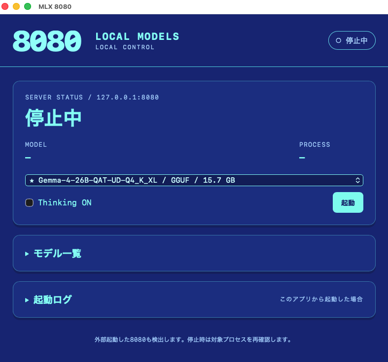

# MLX Model Switcher — MLX 8080

[](https://github.com/yukincom/mlx-model-switcher/actions/workflows/ci.yml)

Apple Silicon上のローカルLLMを、macOSアプリまたはターミナルから起動・停止するためのツールです。保存済みモデルの登録、表示名、デフォルトモデル、Thinkingの設定と、使用中モデルを保護した削除を扱います。推論APIは `http://127.0.0.1:8080/v1` です。



## 構成

- **MLX 8080.app**: AppKit / WKWebViewの画面とSwift製管理サーバー（`127.0.0.1:8766`）。モデル一覧、起動停止、設定保存、削除保護もSwiftで実行します。
- **start_server.sh**: MLX-LMの起動、キャッシュ解決、オフライン設定を担う共通ランチャー。アプリとCLIのどちらも同じ起動経路を使います。
- **推論プロセス**: 管理アプリから独立して動作します。ウィンドウを閉じる、またはアプリを終了しても推論は継続します。

管理画面の定期ポーリングはありません。管理API操作、起動記録・ログのファイル変更、対象PIDの終了を通知して表示を更新します。エージェントが管理APIや起動スクリプトを使った場合も自動反映します。画面の再表示時には現在の状態を取得します。

標準の推論バックエンドはMLX-LMです。スクリーンショットのGGUFは[llama.cppとの連携](docs/gguf-integration.md)によるもので、このリポジトリにllama.cppやモデル重みは含みません。Pythonを使用するのはMLX-LMの推論と開発用ツールです。

## セットアップ

macOS 14以降、Apple Silicon、Python 3.11以降、Xcode Command Line Toolsが必要です。アプリはランチャーの絶対パスをビルド時に記録するため、その配置を変更した場合は再ビルドしてください。

```bash
git clone https://github.com/yukincom/mlx-model-switcher.git ~/mlx-server
cd ~/mlx-server
python3 -m venv .venv
.venv/bin/python -m pip install --upgrade pip certifi
.venv/bin/python -m pip install 'mlx-lm==0.31.3'
.venv/bin/python tools/build_apps.py --output /Applications
open '/Applications/MLX 8080.app'
```

モデルは事前にダウンロードしてください。アプリの「モデル一覧」からHugging Faceキャッシュ内のモデルを登録できます。`models.conf`を編集する場合は、1行を `alias=Hugging Face ID` または `alias=/absolute/path/to/model` とします。相対パスは `./models/example` のように指定します。起動時に不足ファイルを自動ダウンロードしたり、remote codeを有効化したりはしません。

## 操作と接続

アプリではモデルとThinking ON/OFFを選んで起動します。別のモデルへ切り替える場合は、稼働中のモデルを停止してから起動します。アプリ外で起動した同じユーザーの8080プロセスも、現在の対象を確認して停止できます。表示名・デフォルト設定・起動一覧からの解除・本体削除は「モデル一覧」から操作します。本体削除では確認画面の後に、プロセスの同一性、使用中ファイル、共有モデル、確認時からの変更を再検査します。

CLIでは次のように操作します。終了は起動したターミナルで `Ctrl+C` です。

```bash
./start_server.sh list
./start_server.sh <alias>
MLX_THINKING=on ./start_server.sh <alias>
./start_server.sh                 # 矢印キーでモデルを選択
```

外部クライアントのBase URLを `http://127.0.0.1:8080/v1` に設定し、`GET /v1/models`が返すモデルIDを使用します。`models.conf`左辺のaliasはランチャーの識別子です。複数クライアントで同じ推論サーバーを共有できますが、同時実行数・コンテキスト長・メモリ使用量はバックエンドとモデル設定に依存します。

エージェントによる操作は[管理API](docs/management-api.md)を参照してください。起動設定、テスト、CI、初回応答の計測は[開発者向けガイド](CONTRIBUTING.md)に記載しています。

## License

MIT License
